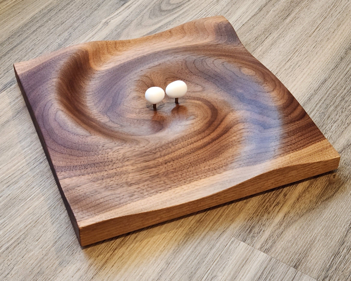
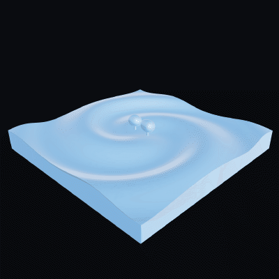

# Tidal NS Sculpture

**Code that designs a gravitational-wave sculpture of a binary neutron star, and generates the files to
make it.**



*The finished default design: resin-printed, tidally deformed neutron stars on 1/8 inch brass posts,
above a CNC-milled walnut base.*

## Overview

Two neutron stars in a tight orbit raise tides on each other and radiate gravitational waves that spiral
outward. This repository turns that physics into an object: a hardwood panel milled with the retarded
field of the orbit, and two neutron stars, deformed by their mutual tide, held above it.

Give it a binary (masses, radii, separation, spins) in a small TOML file and it produces everything
needed to build the piece, then checks the design against the milling and assembly constraints.

**What the repository provides**

- **The panel.** The retarded gravitational field of the two stars, carved as a relief, exported as a
  closed STL for CAM and as a 16-bit heightmap.
- **The stars.** Meshes shaped from the f-mode tidal amplitudes of Yu et al.
  ([arXiv:2211.07002](https://arxiv.org/abs/2211.07002),
  [arXiv:2404.00147](https://arxiv.org/abs/2404.00147)): triaxial, with the bulge lagging the companion
  and, optionally, the flattening of an anti-aligned spin.
- **The assembly.** Post sockets sized for 1/8 inch brass rod, the star height that clears the carved
  relief, rod lengths, and a positioned preview.
- **Validation.** Milling slope and curvature, wood left under the post holes, star clearance, the
  star–star gap and a linear-regime check; a bad design fails with a message.
- **Documentation.** The design, the shape specification and the full derivation from orbit to surface
  (see [Documentation](#documentation)).

The default design is a 1.6 + 1.2 M☉ binary at a 33 km separation, scaled so one gravitational
wavelength is 212 mm. Everything is Python and builds in about half a minute.

## Gallery



*A rotating render of the assembled design.*


*The milling heightmap produced by `build_all.py` (light = high, dark = deep; 254 × 254 mm panel,
20 mm relief).*

## What you get

`python build_all.py` writes into `out/default/` (not committed; ~30 MB):

| File | Contents |
|---|---|
| `plate_relief.stl` | closed solid of the carved panel, 254 × 254 × 36 mm, for CAM (no post holes) |
| `plate_heightmap.png` + `.json` | the same relief as a 16-bit depth map, with its $z$-range |
| `ns_heavy_1p6.stl`, `ns_light_1p2.stl` | the two stars, watertight, with a Ø3.375 mm post socket |
| `ns_*_sphere.stl` | undeformed comparison stars of the same size |
| `star_modes.toml` | the tidal amplitudes the stars were built from |
| `assembly_preview.stl` | everything positioned, for rendering only |

The build also runs the validation described above.

## Quick start

Python 3.11 or newer.

```bash
pip install -r requirements.txt
python build_all.py        # ~30 s, writes out/default/
python -m pytest           # ~15 s
```

Output goes to `out/<name of the configuration file>/`, so several designs can sit side by side.

## Make your own

A design is one TOML file. Copy [`configs/default.toml`](configs/default.toml), which lists every
setting with its meaning, change what you want (every key is optional; omitted keys take the default,
and a misspelled key is an error), and build it:

```bash
cp configs/default.toml configs/mine.toml     # edit: masses, radii, separation, spins, panel, relief...
python build_all.py --config configs/mine.toml   # writes out/mine/
```

[`configs/equal_mass.toml`](configs/equal_mass.toml) is a short example (1.4 + 1.4 M☉, nonspinning).

What the build does for you:

- regenerates the star amplitudes for the configured binary and **refuses** configurations outside the
  linear regime (for example a spin that puts the snapshot past a mode's resonance);
- derives the star height that gives the required clearance over the carved relief;
- names the star files from the masses (`ns_heavy_1p6.stl`, ...);
- validates milling slope and curvature, wood under the post holes, star height, the star–star gap, and
  stops with a message if a check fails.

Things to know:

- `field.z_eval_mm`, `field.c_eff_factor` and `panel.relief_pp_mm` set the *look* of the panel and its
  milling margins; they interact ([`docs/design.md`](docs/design.md) §3.4–§5.1). Re-run the build and
  read the validation after changing any of them.
- `panel.grid_step_mm` sets only the resolution of the exported plate STL and heightmap (default 2 mm,
  a ~3 MB file); the carved field and every check are independent of it.
- The stellar model is a Γ=2 polytrope; the tidal amplitudes are linear and Newtonian.
- Each design is validated only against the constraints the build checks; the default design is the one
  that has been looked at in detail.

## How it works

```
configs/*.toml ──► params.py ──► binary.py  (orbit, scale S, star positions)
                                   │
                                   ├──► wavefield.py ──► plate.py ──► plate_relief.stl, heightmap
                                   │      retarded per-star potential, carved as retarded − instantaneous
                                   │
tools/make_star_modes.py ──► star_modes.toml ──► tidal_shape.py ──► star.py ──► ns_*.stl
   polytrope.py (stellar model)                    amplitudes → r(θ, φ)
   tidal_waveform.py (f-mode amplitudes)
                                   │
                                   └──► validate.py   checks everything against the milling and assembly constraints
```

## Documentation

- [`docs/design.md`](docs/design.md) — the system as built: field model, panel geometry, milling,
  star geometry, posts and assembly, deliverables, known limitations.
- [`docs/neutron_star_shape.md`](docs/neutron_star_shape.md) — specification of the deformed stellar
  surface, with its validation checks (V1–V12).
- [`docs/math.md`](docs/math.md) — derivation of every formula from the orbit to the surface, with
  a worked example for the sculpture's heavy star.

## Verification

- `python -m pytest` — the shape math, the amplitude pipeline, the regime gate and an independent
  float64 re-derivation of the worked example.
- `python verification/math_walkthrough.py` — prints the worked example of `docs/math.md` step by step.
- `python verification/verify_amplitudes.py` — compares the amplitude generator with a time-domain
  integration of the mode equation (a few minutes).

## Limitations

This is an artwork built on real physics, not a simulation of a binary neutron star merger:

- The panel is not a strain map. The field is a retarded Newtonian potential difference, evaluated
  off the orbital plane, with a wave speed of $0.35\,c$, and normalized to the relief depth.
- The stars are a linear, Newtonian $\Gamma=2$ polytrope response at one orbital frequency; the orbit
  is Keplerian even though $v/c\approx0.35$.
- Do not quote strain values from the piece. See `docs/design.md` §10 for the full list.

## Credits and licence

The amplitude model implements Yu, Weinberg, Arras, Kwon & Venumadhav (arXiv:2211.07002) and Yu,
Arras & Weinberg (arXiv:2404.00147); please cite those papers if you use the stellar shapes.

[MIT](LICENSE).
